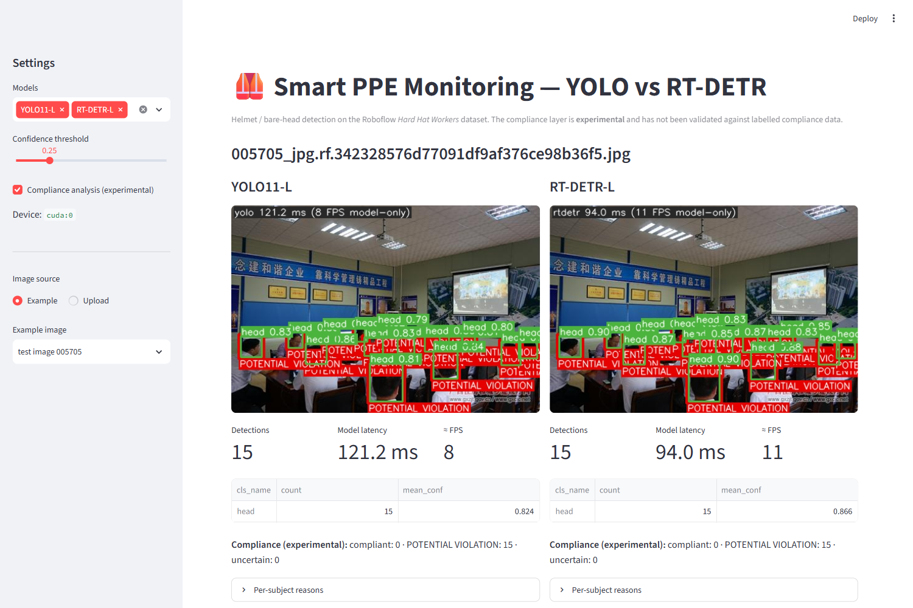

# Smart PPE Monitoring — YOLO vs RT-DETR for hard-hat detection

Fine-tune and fairly compare a CNN-based detector (**Ultralytics YOLO11**) with a Transformer-based detector
(**RT-DETR**) on the public *Hard Hat Workers* dataset, then run image/video inference with an
**experimental**, deliberately cautious helmet-compliance layer.

> **Status.** Full pipeline implemented and **run end to end on Kaggle (T4) with the real dataset**: both models were
> fine-tuned for 20 epochs and evaluated once on the held-out test split; results are in Section 12. Caveats up front:
> single seed, 20 epochs (limited by the 6 h/week Kaggle GPU quota, not by convergence — RT-DETR may benefit from more),
> and the `person` class is essentially undetected by both models. The compliance layer is experimental/unvalidated.
> See the [Verification log](#verification-log).

**Full experiment report:** [REPORT.md](REPORT.md) · **Demo screenshot:** [docs/streamlit_demo.png](docs/streamlit_demo.png)

## 1. Problem statement
Given an image or video of a work site, locate workers' heads/helmets and decide, only where the evidence supports
it, whether a worker is wearing a helmet. This is **object detection** (what + where: boxes, classes, confidences),
not image classification (one label per image).

**Violation definition used here:** a *potential* violation is a **positively detected bare head** (`head` class,
confidence ≥ `evidence_conf`) with no helmet evidence. A missing helmet detection alone is **never** a violation
(occlusion, blur, small size, or a miss would all look the same). Everything else is `uncertain`.
Reflective vests are **not** supported — this dataset has no vest annotations.

## 2. System architecture
```
image / video ─► OpenCV decode ─► Detector (YOLO | RT-DETR, one letterbox resize inside Ultralytics)
  ─► boxes + class + confidence ─► safety/compliance.py (separate, configurable, EXPERIMENTAL)
  ─► annotated image/video + JSON (detections, timings, subject statuses) + FPS stats
```
Training / evaluation / benchmarking are separate modules; safety rules never touch model code.
Detection metrics (mAP etc.) and compliance logic are reported separately — compliance has no ground truth in this
dataset and is **not** evaluated.

## 3. Why these two models
| | YOLO11 (baseline) | RT-DETR-L |
|---|---|---|
| Features | CNN backbone + neck | CNN backbone + hybrid encoder (self-attention on the lowest-res scale only, CNN-style cross-scale fusion) |
| Head | Anchor-free dense predictions | Transformer decoder with object queries seeded from top-scoring encoder features |
| Duplicate removal | **NMS** (IoU threshold) | **None** — Hungarian one-to-one matching during training |
| Typical trade-off | Fast, small, strong on small data | Transformer global reasoning, larger, needs lower LR |

RT-DETR is an object-detection architecture, not a Vision Transformer image classifier. Both run through the
installed Ultralytics (8.3.27) training/validation APIs (`YOLO`, `RTDETR`), so data, augmentation pipeline and
metric code are identical. Pretrained COCO checkpoints: `yolo11l.pt`, `rtdetr-l.pt` (auto-downloaded).

## 4. Dataset
* Source: Roboflow *Hard Hat Workers* — https://public.roboflow.com/object-detection/hard-hat-workers
  (redirects to `universe.roboflow.com/joseph-nelson/hard-hat-workers`).
* What I could and could not verify: the page blocked automated access (HTTP 403), so I relied on a web search
  summary: classes `helmet`, `head`, `person`; derived from a Northeastern University (China) hard-hat dataset;
  ~7k images; license shown as *Public Domain*; several exported versions with different splits/classes.
  **Unverified — check the dataset page yourself** for the exact version, split sizes and license, and record them in
  `outputs/dataset_report.json` (generated by the validator) before reporting results.
* **Checked via Kaggle mirror `hebaomer/hard-hat-workers`** (file listing + its README/`data.yaml`; images themselves not
  inspected): Roboflow `joseph-nelson/hard-hat-workers` **v2 "raw_75-25_trainTestSplit"**, YOLOv8 format, 7041 images
  (train 5269 + test 1766, **no valid folder** despite `data.yaml` listing one), classes `['head','helmet','person']`,
  license Public Domain (Roboflow) / CC0-1.0 (Kaggle metadata), only auto-orient preprocessing, no augmentation.
* Because that export has no validation split, `python -m smart_ppe.data.make_val_split --src SRC --dst DST` carves a
  seeded 15 % validation set out of *train* (test copied untouched). Caveat: if the source images contain
  near-duplicates, a random split can leak between train and val (test is unaffected); the validator only detects
  byte-identical duplicates.
* Any export works if it has train / valid(or val) / test; the code reads real class names from `data.yaml`.
* Annotation format is YOLO txt, which Ultralytics RT-DETR trains on directly → **no COCO conversion was needed**
  (so no `convert_annotations.py`).
* Limitations: construction-site imagery, mostly daylight/medium distance; class imbalance across `helmet/head/person`;
  Roboflow-augmented versions can contain near-duplicates (the validator only catches byte-identical leakage).

## 5. Installation (Windows / Linux)
```bash
python -m venv .venv && .venv\Scripts\activate          # Linux: source .venv/bin/activate
# install a CUDA build of torch/torchvision from https://pytorch.org if you want GPU
pip install -r requirements.txt
pip install -e .                                          # or: set PYTHONPATH=src
pytest -q
```
Tested: Python 3.11.5, torch 2.5.1+cu124, ultralytics 8.3.27, opencv 4.11.0.86 on an RTX 3050 Laptop (4 GB).

## 6. Dataset preparation
```bash
# download the YOLOv8 export from Roboflow (web UI or API) and unzip it
set PPE_DATASET_ROOT=D:\data\hard-hat-workers            # Linux: export PPE_DATASET_ROOT=...
python -m smart_ppe.data.validate_dataset --config configs/dataset.yaml
```
Checks: split folders, image/label pairing, 5-field lines, class ids, box validity (positive size, inside image),
role→class mapping (`configs/dataset.yaml: roles`), minimum split sizes, byte-identical images across splits.
Writes `outputs/dataset_report.json` and `outputs/data_resolved.yaml` (absolute paths, generated, git-ignored).

## 7. Training (local or Kaggle)
```bash
python -m smart_ppe.training.train_yolo   --config configs/yolo.yaml
python -m smart_ppe.training.train_rtdetr --config configs/rtdetr.yaml
# quick pipeline check:
python -m smart_ppe.training.train_yolo --config configs/yolo.yaml --set train.epochs=1 --set train.fraction=0.02
```
Each run writes `outputs/runs/<name>/` with `weights/best.pt`, `config.yaml`, `results.csv`, curves, and
`train_summary.json` (training seconds, model size, params, peak training GPU memory, library versions, **validation**
metrics). Model size is configurable (`model:` e.g. `yolo11s.pt`, `rtdetr-x.pt`). The 4 GB local GPU is not expected
to train the default `-l` models at 640 — use Kaggle, or reduce `batch`/`imgsz`/model size locally.

## 8. Kaggle T4 workflow
1. New Notebook → upload `notebooks/kaggle_training.ipynb` (regenerate with `python scripts/make_notebook.py`).
2. Settings → Accelerator **GPU T4 x1**, Internet **On**.
3. The project source is **embedded in the notebook** (nothing else to upload). Provide only the dataset: attach your
   uploaded YOLOv8 export and set `DATASET_DIR`, **or** add Kaggle Secret `ROBOFLOW_API_KEY` and set `RF_VERSION`.
   Set `SMOKE = True` in the setup cell for a few-minute dry run first, then set it back to `False`.
4. Everything runs on Kaggle — validation, model loading, training, evaluation, benchmarking. Run all cells: GPU check → validate → train YOLO → train RT-DETR (sequential, one model on the GPU at a time) →
   evaluate on **val**, then **test once** → comparison tables/plots → `/kaggle/working/ppe_results.zip` in the Output panel.

The notebook was run on Kaggle (T4) by pushing it with the Kaggle API: one smoke run (1 epoch, 10 % of train) then the full run (`EPOCHS = 20`). Raise `EPOCHS` (default config is 50) only if your weekly GPU quota allows: measured ≈ 3.5 min/epoch for YOLO11-L and ≈ 6.5 min/epoch for RT-DETR-L (batch 8, 640 px, T4).

## 9. Evaluation methodology (fairness)
* Same train/val/test files for both models (one `data_resolved.yaml`), seed `0`, `deterministic: true`.
* Same `imgsz=640`, `epochs=50`, `batch=8`, AdamW, AMP, early-stopping `patience=15`, same Ultralytics augmentation defaults.
* **Documented difference:** `lr0` is `0.001` (YOLO) vs `0.0001` (RT-DETR) because transformer decoders are
  unstable at CNN-style learning rates. Warm-up, LR schedule shape and weight decay are Ultralytics defaults for both.
  Convergence speed also differs, so equal epochs ≠ equal "optimality"; report training time too.
* Model selection (best epoch, config choices) uses **val**. The **test** split is evaluated once at the end with
  `evaluate --split test`.
* Metrics via the Ultralytics validator at `conf=0.001`: precision, recall (at the F1-optimal confidence reported by
  Ultralytics), mAP@50, mAP@50:95, per-class values, confusion matrix (PNG in `outputs/eval/...`).
* FP/FN analysis (our code): class-aware greedy IoU≥0.5 matching at `conf=0.25`; saves worst-FP, worst-FN and clean-TP
  example images. These counts use a different threshold than mAP and are not comparable to it.
* Speed (`evaluation/benchmark.py`): batch 1, same 200 test images pre-decoded in RAM, same `imgsz`/`conf`/device,
  20 warm-up passes, CUDA synchronised, models run sequentially. Reports preprocess / inference / postprocess means,
  medians, p95; **FPS excludes video decoding and drawing** (`includes_video_decoding: false`). Peak GPU memory is
  `torch.cuda.max_memory_allocated` during the timed loop (CUDA only). Video demo `end_to_end_fps` *does* include decode,
  drawing and encoding and is labeled as such.

```bash
python -m smart_ppe.evaluation.evaluate --model yolo   --weights outputs/runs/yolo/weights/best.pt   --split val
python -m smart_ppe.evaluation.evaluate --model rtdetr --weights outputs/runs/rtdetr/weights/best.pt --split val
python -m smart_ppe.evaluation.evaluate --model yolo   --weights outputs/runs/yolo/weights/best.pt   --split test
python -m smart_ppe.evaluation.evaluate --model rtdetr --weights outputs/runs/rtdetr/weights/best.pt --split test
python -m smart_ppe.evaluation.compare_models --config configs/inference.yaml   # benchmark + tables + plots
```
Outputs in `outputs/metrics/`: `<model>_<split>.json`, `*_per_class.csv`, `<model>_benchmark.json`,
`comparison.{csv,json,md}`, plots, and `<model>_training_curves.png`.

### Concepts in brief
* **Detection vs classification:** classification outputs one label per image; detection outputs a set of
  (box, class, confidence).
* **IoU** = area(intersection)/area(union) of two boxes; a prediction is a true positive if it has the right class
  and IoU ≥ threshold. **NMS** drops lower-scoring boxes overlapping a higher-scoring one (YOLO); RT-DETR avoids it
  through one-to-one set prediction.
* **Precision** = TP/(TP+FP); **recall** = TP/(TP+FN). **AP** is the area under the precision–recall curve per class;
  **mAP@50** averages AP at IoU 0.5, **mAP@50:95** averages over IoU 0.50…0.95 (stricter localisation).
* **Latency** = time for one image; **FPS** = throughput = images/second. They differ when batching or pipelining;
  here both are batch-1 so FPS ≈ 1000/latency_ms.
* **Why controlled benchmarks:** different hardware, resolution, batch size, thresholds (NMS cost depends on how many
  boxes survive `conf`), warm-up, or counting decode/drawing time can each change results by more than the gap between models.

## 10. Inference
```bash
python -m smart_ppe.inference.predict_image --model yolo   --weights PATH.pt --source "path with spaces/img.jpg" --conf 0.25
python -m smart_ppe.inference.predict_video --model rtdetr --weights PATH.pt --source clip.mp4 --stride 1
```
Outputs (default `outputs/predictions/`): annotated image/video + `.json` (detections, per-stage timings, compliance
subjects, FPS statistics). Invalid paths, unsupported formats and unreadable videos produce a clear error and exit code 2.
`--no-compliance` gives detection only; `--stride N` runs the model on every Nth frame.

### Compliance layer (experimental)
`safety/compliance.py`: helmet/head boxes are associated with a person box if ≥50 % of the helmet/head box lies in
the person's *head region* (top 40 % of the person box, extended 10 % upward). Helmets need not overlap the whole person
box; unassociated helmets/heads become standalone subjects. Verdicts: `compliant` (strong helmet), `potentially_non_compliant`
(strong bare head, no helmet evidence, big enough, not cropped), otherwise `uncertain`. Thresholds live in
`configs/inference.yaml`. **Limitations:** 2-D boxes can't tell a helmet carried in hand from one worn, can't handle
heavy occlusion, crowded overlaps can mis-associate heads, and the heuristic is not validated against labeled
compliance data — treat it as a demo, not a safety system.

## 11. Project layout
```
configs/        dataset / yolo / rtdetr / inference YAML
src/smart_ppe/  data (validator) · models · training · evaluation · inference · safety · utils
scripts/        make_smoke_dataset.py (synthetic, pipeline tests only) · make_notebook.py
notebooks/      kaggle_training.ipynb
tests/          48 pytest tests (no downloads, mocked inference)
app/            streamlit_app.py (demo)   ·   demo_samples/ (6 test images)   ·   docs/ (screenshot)
```

## 12. Results (Kaggle T4, test split = 1766 images, 20 epochs, seed 0, imgsz 640)
Source: `outputs/metrics/*.json` produced by the notebook (`comparison.md`). Dataset: Roboflow v2 export with a seeded
15 % validation split carved from train (train 4479 / val 790 / test 1766 images).

| Model | Precision* | Recall* | mAP@50 | mAP@50:95 | Latency ms | FPS | Size MB | Params M | Train time |
|---|---|---|---|---|---|---|---|---|---|
| YOLO11-L | 0.963 | 0.632 | 0.661 | 0.469 | 25.4 | 39.3 | 48.8 | 25.3 | 1.20 h |
| RT-DETR-L | 0.625 | 0.629 | 0.652 | 0.454 | 54.4 | 18.4 | 63.1 | 32.0 | 1.88 h |

\*All-class values from the Ultralytics validator. Latency = pre+inference+post mean, batch 1, 200 test images, 20 warm-up,
excludes decoding/drawing; peak GPU memory ≈ 234 MiB for both (allocator peak, batch 1). Validation-split mAP@50:95 was
0.467 (YOLO) / 0.448 (RT-DETR), consistent with test.

**Per class (test):**

| Class | YOLO mAP@50 | YOLO mAP@50:95 | RT-DETR mAP@50 | RT-DETR mAP@50:95 |
|---|---|---|---|---|
| head | 0.969 | 0.688 | 0.963 | 0.675 |
| helmet | 0.985 | 0.702 | 0.981 | 0.682 |
| person | 0.030 | 0.016 | 0.010 | 0.006 |

**How to read this honestly**
* On the two classes that matter for helmets (`head`, `helmet`) the models are close: mean mAP@50 0.977 vs 0.972,
  mAP@50:95 0.695 vs 0.678. With one seed the 0.01–0.02 gaps are **not** evidence that YOLO is more accurate.
* The all-class mAP (~0.66) is dragged down by **`person`** (only 376 training boxes; recall 0 for both). The all-class
  *precision* gap (0.963 vs 0.625) is an artefact of that class (P=1.0 at zero recall for YOLO, 0.0 for RT-DETR); over
  head+helmet precision is 0.944 vs 0.937. Prefer mAP and per-class numbers.
* Error analysis at conf 0.25, IoU 0.5 (not comparable to mAP): YOLO 493 FP / 418 FN; RT-DETR 1454 FP / 288 FN —
  RT-DETR trades more false positives for fewer misses at this threshold (no NMS, many low-confidence queries).
* Robust difference: **speed** — YOLO ≈ 2.1× faster at batch 1 on the T4 and trained in ~64 % of the time.
* Training had not fully converged for either model (best epoch 20/20 for YOLO, 18/20 for RT-DETR; curves flat to
  +0.001–0.003 per epoch at the end). RT-DETR in particular may gain from the originally planned 50 epochs.

Artifacts (after extracting `ppe_results.zip` into `outputs/`): `outputs/metrics/` (JSON/CSV, comparison tables, bar charts,
training curves), `outputs/eval/<model>_test/` (confusion matrices, PR curves, `examples/` TP/FP/FN images).
Not produced: annotated video demo, multi-seed variance.

## 12b. Streamlit demo
```bash
pip install -r requirements.txt && pip install -e .
# get the trained weights: download ppe_results.zip from the Kaggle notebook Output tab and extract it into outputs/
streamlit run app/streamlit_app.py
```
Choose an example (`demo_samples/`, 6 images from the *test* split, CC0/Public Domain) or upload your own, compare both
models side by side, adjust the confidence threshold, toggle the experimental compliance analysis. Latency shown is on
your machine (first call is warmed up).



## 13. Limitations and future work
Single dataset/domain; compliance logic unvalidated; no tracking (a worker flickers between statuses across frames —
temporal smoothing/tracking would help); no vest/other PPE classes (needs an additional documented dataset);
single seed (variance not measured — run several seeds); no export/TensorRT/ONNX benchmarking; fixed-confidence FP/FN analysis.

## 14. Reproducibility
Pinned `requirements.txt`; seeds in configs; `train_summary.json` stores library versions, GPU and the config copy;
dataset root only via `PPE_DATASET_ROOT`/YAML; generated data YAMLs never committed; `.gitignore` excludes datasets, weights, videos.

## Verification log
Executed on Windows 11, RTX 3050 Laptop 4 GB, torch 2.5.1+cu124, ultralytics 8.3.27:
* `pytest -q` → **48 passed** (dataset/label validation, class mapping, configs, confidence handling, compliance logic,
  mocked detector output structure, video frame handling, metric parsing, comparison-report generation).
* `--help` of all 8 CLI modules works.
* Local smoke test on synthetic shapes (`scripts/make_smoke_dataset.py`) of the whole pipeline with `yolo11n`/`rtdetr-l`.
* **Kaggle T4, real data (Python 3.13, torch 2.11+cu128, ultralytics 8.3.27):** smoke run (all stages), then the full 20-epoch
  run → validate → train both → evaluate val and test → benchmark → comparison tables/plots. Bugs found there and fixed:
  Ultralytics' Ray Tune callback crashes on Kaggle (integrations are now disabled), notebook steps now stop on failure,
  missing `shutil` import, the export has no validation split (now carved from train).
* Streamlit app: headless `AppTest` (both models, real weights, parameter changes) and a visual check via screenshot.

**Not executed:** multi-seed runs, 50-epoch runs, annotated video demo on real footage, any validation of the compliance
heuristic against labelled data, deployment/export (ONNX/TensorRT).

## CV summary (edit once real results exist)
*Built and ran a reproducible YOLO11 vs RT-DETR helmet-detection pipeline (Ultralytics, PyTorch, OpenCV): dataset validation,
sequential Kaggle-T4 training workflow, controlled latency/FPS benchmarking, FP/FN analysis, and an experimental
rule-based helmet-compliance layer with a unit-tested, uncertainty-aware design (48 tests).* Measured (single seed, 20 epochs, test split): head/helmet mAP@50 ≈ 0.97 for both models; YOLO11-L ≈ 2.1× faster than RT-DETR-L at batch 1 on a T4.

## License
Code: MIT (see `LICENSE`). Dataset: check the license on the dataset page.
