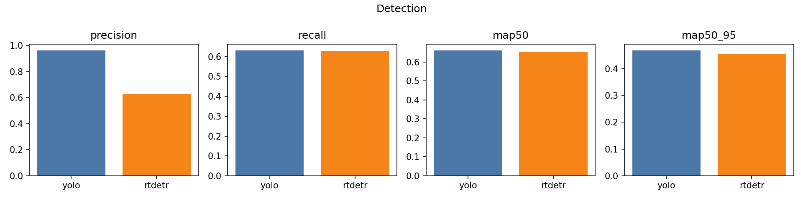
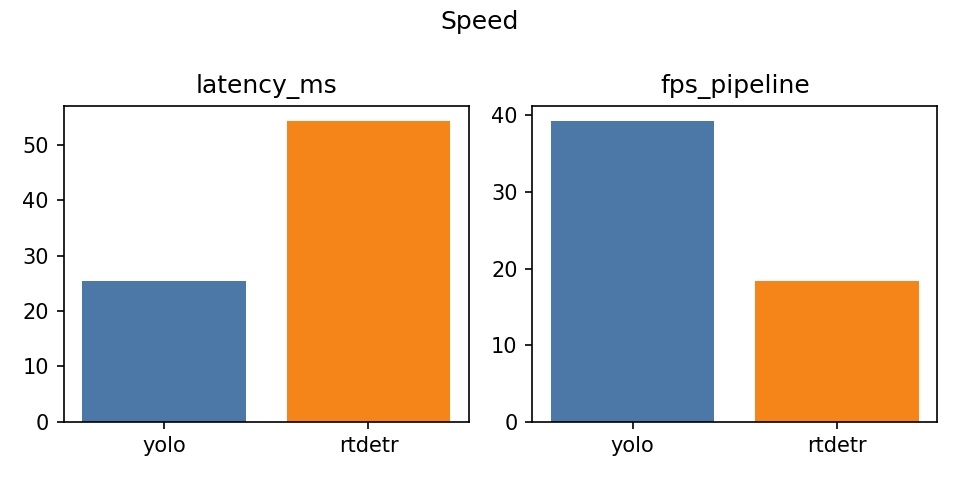
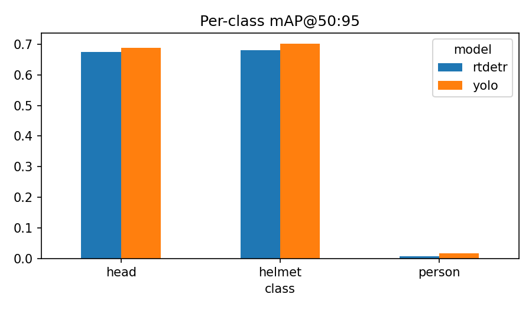
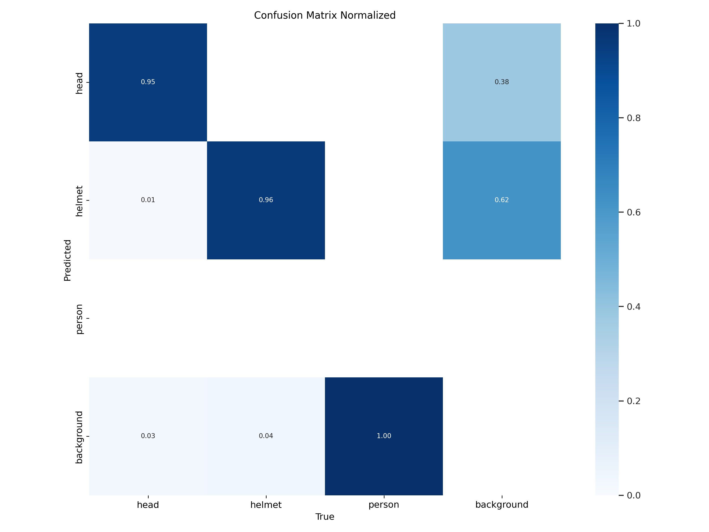
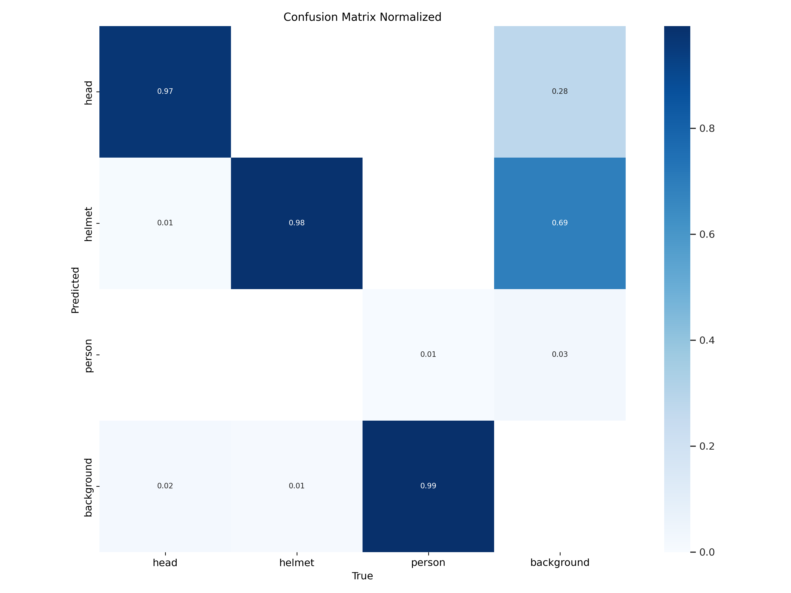
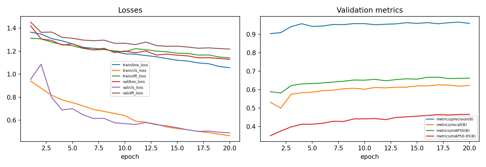
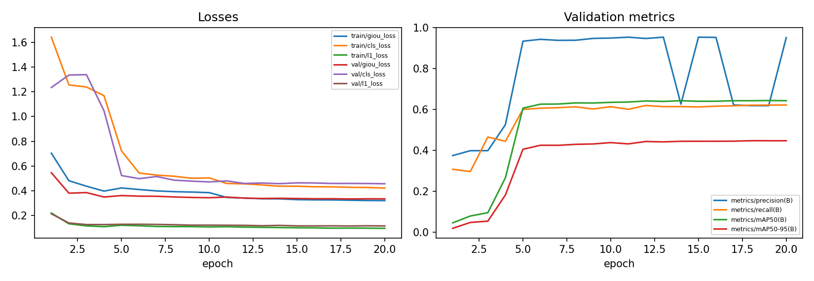

# Experiment Report — YOLO11-L vs RT-DETR-L for Helmet Detection

*Date of runs: 2026-10-10. Hardware: Kaggle Tesla T4 (16 GB). Software: Python 3.13, torch 2.11.0+cu128,
Ultralytics 8.3.27. All numbers below come from `docs/results_comparison.json` and the run logs; nothing is estimated
except where explicitly marked.*

## 1. Summary

* Two pretrained COCO detectors — **YOLO11-L** (CNN + NMS) and **RT-DETR-L** (CNN backbone + hybrid encoder +
  Transformer decoder, no NMS) — were fine-tuned for **20 epochs** on the same data with the same seed, resolution
  (640), batch size (8) and optimizer family (AdamW), and evaluated **once** on the untouched test split (1766 images).
* On the two classes that matter for helmets, `head` and `helmet`, the models are **close** (mean mAP@50 0.977 vs 0.972).
  The measured accuracy gap (0.01–0.02 mAP) comes from **one seed** and is not evidence of a real difference.
* The robust difference is **speed**: YOLO11-L runs ≈ **2.1× faster** at batch 1 on the T4 (39.3 vs 18.4 FPS) and trained
  in ≈ 64 % of the time.
* **The `person` class is essentially undetected by both models** (test mAP@50 0.03 / 0.01, recall ≈ 0). This pulls the
  all-class mAP down to ≈ 0.66 and distorts all-class precision, so per-class numbers must be read instead.
* The compliance layer (helmet/bare-head reasoning) is **experimental and has not been validated** against labelled
  compliance data.

## 2. Task and dataset

Detect `head` (bare head), `helmet` and `person` in workplace images; derive cautious compliance statuses from the detections.

* Source: Roboflow *Hard Hat Workers* (`joseph-nelson/hard-hat-workers`), **v2 "raw_75-25_trainTestSplit"**,
  YOLOv8 format, 7041 images, auto-orient only, no augmentation. Provided by Northeastern University – China;
  license Public Domain (Roboflow) / CC0-1.0 (Kaggle metadata). Used via the Kaggle mirror `hebaomer/hard-hat-workers`.
  I verified the file listing, README and `data.yaml` of the mirror, not every image.
* The export ships **train (5269) and test (1766) only**. A seeded (seed 0) **15 % validation split** was carved out of
  train (`smart_ppe.data.make_val_split`): train 4479 / val 790 / test 1766. The test split is copied unchanged.
* Boxes per split:

| Split | Images | head | helmet | person |
|---|---|---|---|---|
| train | 4479 | 4239 | 12728 | 376 |
| val | 790 | 635 | 2156 | 97 |
| test | 1766 | 1803 | 4863 | 142 |

`person` has ~30× fewer boxes than `helmet` — the main data limitation of this study.

## 3. Methods

### Models
| | YOLO11-L | RT-DETR-L |
|---|---|---|
| Family | CNN backbone + neck, anchor-free head | CNN backbone + hybrid encoder (self-attention on the lowest-resolution scale only) + Transformer decoder with object queries |
| Duplicate removal | NMS (IoU 0.7) | none (one-to-one set prediction, Hungarian matching in training) |
| Pretrained | `yolo11l.pt` (COCO) | `rtdetr-l.pt` (COCO) |
| Parameters / file size | 25.3 M / 48.8 MB | 32.0 M / 63.1 MB |

RT-DETR is an object-detection architecture, not an image classifier.

### Fair protocol
* Identical splits (one generated data YAML), seed 0, `deterministic=True`, imgsz 640, batch 8, 20 epochs, AdamW, AMP,
  default Ultralytics augmentation and schedule; models trained sequentially on the same T4.
* **Documented difference:** `lr0` = 0.001 (YOLO) vs 0.0001 (RT-DETR); transformer decoders are unstable at CNN-style rates.
  Equal epochs do not mean equal convergence.
* Model selection used the **validation** split only; the **test** split was evaluated once at the end.
* Detection metrics: Ultralytics validator at conf 0.001 (precision/recall reported at its best-F1 confidence).
  Error analysis (own code): class-aware greedy matching at conf 0.25, IoU 0.5 — not comparable to mAP.
* Speed: batch 1, first 200 test images pre-decoded in RAM, 20 warm-up passes, CUDA synchronised; excludes video decoding
  and drawing; peak GPU memory from `torch.cuda.max_memory_allocated`.

### Deviation from the original plan
The default configs specify **50 epochs**. Measured cost on the T4 was ≈ 3.5 min/epoch (YOLO) and ≈ 6.5 min/epoch
(RT-DETR), i.e. ≈ 8.5 GPU-hours for 50 epochs, above the account's 6 GPU-hours/week quota, so both models were trained
for **20 epochs**. Neither model had fully converged (see §5).

## 4. Results (test split, 1766 images)

| Model | Precision* | Recall* | mAP@50 | mAP@50:95 | Latency (ms) | FPS | Peak GPU MiB | Train time |
|---|---|---|---|---|---|---|---|---|
| YOLO11-L | 0.963 | 0.632 | 0.661 | 0.469 | 25.4 | 39.3 | 234 | 1.20 h |
| RT-DETR-L | 0.625 | 0.629 | 0.652 | 0.454 | 54.4 | 18.4 | 235 | 1.88 h |

\*All-class values. Latency = mean of preprocess + inference + postprocess (YOLO 1.9 + 22.4 + 1.1 ms; RT-DETR 2.4 + 51.4 + 0.6 ms;
p95 total 28.9 / 56.0 ms). Validation mAP@50:95 was 0.467 (YOLO) and 0.448 (RT-DETR), consistent with test.

### Per class (test)
| Class | Model | Precision | Recall | mAP@50 | mAP@50:95 |
|---|---|---|---|---|---|
| head | YOLO | 0.931 | 0.943 | 0.969 | 0.688 |
| head | RT-DETR | 0.919 | 0.940 | 0.963 | 0.675 |
| helmet | YOLO | 0.958 | 0.952 | 0.985 | 0.702 |
| helmet | RT-DETR | 0.955 | 0.948 | 0.981 | 0.682 |
| person | YOLO | 1.000 | 0.000 | 0.030 | 0.016 |
| person | RT-DETR | 0.000 | 0.000 | 0.010 | 0.006 |

Macro over `head`+`helmet`: YOLO P 0.944 / R 0.948 / mAP@50 0.977 / mAP@50:95 0.695; RT-DETR P 0.937 / R 0.944 /
mAP@50 0.972 / mAP@50:95 0.678.

### Confusion matrices (normalised, test)

Both models classify `head` vs `helmet` almost perfectly (0.95–0.98 on the diagonal, ≤ 0.01 cross-confusion). 99–100 % of
true `person` boxes are predicted as background.

### False positives / negatives at conf 0.25, IoU 0.5
| Model | TP | FP | FN |
|---|---|---|---|
| YOLO11-L | 6390 | 493 | 418 |
| RT-DETR-L | 6520 | 1454 | 288 |

RT-DETR misses fewer objects but produces ~3× more false positives at this threshold (head FP 174 vs 410, helmet FP 319 vs
1000): without NMS it emits many low-confidence queries that a higher threshold would filter. Annotated TP/FP/FN example
images are generated by `smart_ppe.evaluation.evaluate` into `outputs/eval/<model>_test/examples/` (not committed).

## 5. Analysis and caveats

1. **Accuracy.** For `head`/`helmet` both detectors are strong (mAP@50 ≈ 0.97–0.99). The ordering YOLO > RT-DETR in every
   row is consistent but small and based on a single seed; seed variance was not measured. No claim of superiority is made.
2. **Precision artefact.** All-class precision 0.963 vs 0.625 is caused by `person`: YOLO reports P = 1.0 at zero recall,
   RT-DETR P = 0.0. Over `head`+`helmet` precision is 0.944 vs 0.937. Compare mAP and per-class values instead.
3. **`person` failure.** Only 376 training boxes (vs 12728 helmet) and, plausibly, inconsistent labelling of when a worker is
   annotated as `person` rather than `head`/`helmet`. I did not investigate the labels; this is a hypothesis.
4. **Convergence.** YOLO's best epoch was 20/20 and RT-DETR's 18/20; mAP@50:95 over the last five epochs rose by only
   ≈ 0.001–0.003 per epoch, so extra epochs would help modestly, probably more for RT-DETR. The planned 50-epoch run was not made.
   
   
5. **Speed.** Measured at batch 1 on a T4 in FP32 with Ultralytics defaults; numbers differ on other hardware/precision/export
   formats. RT-DETR's cost is dominated by the network (51 ms) while YOLO's is smaller; NMS is cheap at conf 0.25.
6. **Fairness limits.** Different learning rates (documented), equal epochs rather than equal convergence, a validation split
   made by random sampling from train (near-duplicate images, if present, could leak between train and val; the test split is
   unaffected), one seed, no confidence intervals.

## 6. Compliance layer (experimental)

`smart_ppe/safety/compliance.py` converts detections into per-subject statuses: **compliant** (helmet evidence),
**potentially non-compliant** (a positively detected bare head with no helmet evidence) or **uncertain** (anything else — a
missing helmet alone is never a violation). Helmet/head boxes are associated with a person through a "head region" (top 40 % of
the person box); unassociated boxes become standalone subjects, which is the common case here because `person` is rarely
detected. Thresholds are configurable (`configs/inference.yaml`). It was exercised by 15 unit tests and visually in the Streamlit
demo (e.g. a meeting-room image with 15 bare heads → 15 potential violations), but **no compliance accuracy was measured** —
the dataset has no compliance labels — and bounding boxes cannot tell a worn helmet from a carried one or handle heavy occlusion.

## 7. Software verification

* 48 unit tests pass (dataset/label validation, class mapping, configs, confidence handling, compliance logic, mocked
  detector output, video frame handling, metric parsing, report generation, validation-split creation).
* Pipeline run end to end on Kaggle T4 with the real data: smoke run (1 epoch, 10 % of train) then the full 20-epoch run.
  Problems found and fixed there: Ultralytics' Ray Tune callback crashing on Kaggle's newer `ray`, notebook steps continuing
  after a failure, a missing import, and the absent validation split.
* A Streamlit demo (`app/streamlit_app.py`) was tested headless and visually.

## 8. Limitations and future work

* Single dataset and domain; single seed; 20 epochs; FP32 only; no export (ONNX/TensorRT) benchmark.
* `person` class unusable → no person-level reasoning; next steps: audit/relabel `person`, class-balanced sampling or a
  dedicated person detector (e.g. COCO-pretrained) feeding the compliance layer.
* Compliance rules need labelled compliance data (or a manually reviewed sample) before any accuracy claim; add tracking and
  temporal smoothing for video.
* Multiple seeds and the 50-epoch schedule to turn the 0.01–0.02 mAP gap into a statistically supported comparison.
* Vest/other PPE would need an additional, separately documented dataset.

## 9. Reproducing

See `README.md`. In short: open `notebooks/kaggle_training.ipynb` on Kaggle (T4, Internet on, attach the dataset), set
`EPOCHS` (default config 50, this report 20), run all cells; results appear in `ppe_results.zip`.
